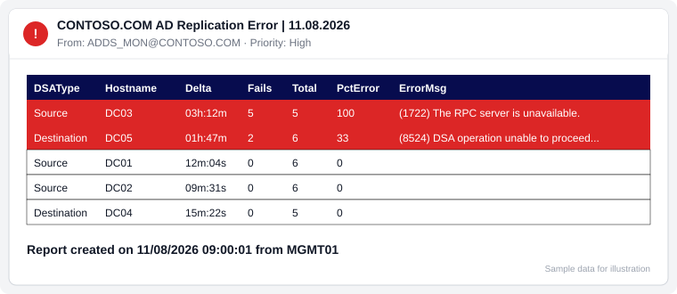
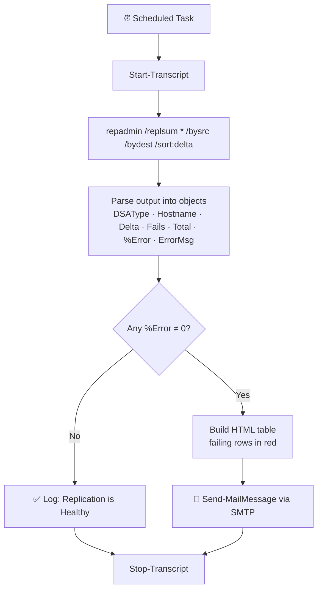

<div align="center">

# 🔁 Active Directory Replication Monitoring

**Free PowerShell script that checks AD replication health across your whole forest and emails you an HTML report when something breaks.**

[](https://learn.microsoft.com/powershell/)
[](#-tested-on)
[](https://github.com/21bshwjt/ActiveDirectory_Replication_Monitoring/actions/workflows/psscriptanalyzer.yml)
[](LICENSE)
[](https://github.com/21bshwjt/ActiveDirectory_Replication_Monitoring/stargazers)
[](https://github.com/21bshwjt/ActiveDirectory_Replication_Monitoring/network/members)

[Quick Start](#-quick-start) · [How It Works](#-how-it-works) · [Configuration](#%EF%B8%8F-configuration) · [FAQ](#-faq) · [Report a Bug](https://github.com/21bshwjt/ActiveDirectory_Replication_Monitoring/issues/new/choose)

</div>

---

## 📋 Why this exists

When Active Directory replication breaks quietly, the damage shows up later: stale passwords, missing Group Policy, lingering objects, and USN rollbacks. `repadmin` tells you everything, but someone has to run it and read the output.

**AD_Repl_Mon.ps1** runs `repadmin /replsum` against **every domain controller in the forest**, turns the output into a colour-coded HTML table, and **emails your team only when replication failures are found**. It needs no agents, no modules to install, and no licences. One script and a Scheduled Task are enough.

<div align="center">
  
  <br><sub><i>Illustration of the alert email layout (sample data)</i></sub>
</div>

---

## ✨ Features

| | Feature | Description |
|---|---|---|
| 🌲 | **Forest-wide check** | Uses `repadmin /replsum * /bysrc /bydest /sort:delta` to cover every DC as both source and destination |
| 📧 | **HTML email alerts** | Clean, styled table. DCs with errors are highlighted in **red** |
| 🔕 | **No noise** | Email is sent **only** when the failure percentage is non-zero; a healthy run just logs |
| 📝 | **Transcript logging** | Every run is written to a timestamped `.log` file for audit and troubleshooting |
| 🔐 | **gMSA friendly** | Runs unattended under a Group Managed Service Account, so no passwords are stored |
| 🪶 | **Zero dependencies** | Only PowerShell 5.1 and `repadmin` (RSAT AD DS tools), both built into DCs |

---

## 🚀 Quick Start

```powershell
# 1. Download the script
New-Item -ItemType Directory -Path C:\Scripts\ADRepl\Logs -Force
Invoke-WebRequest -Uri https://raw.githubusercontent.com/21bshwjt/ActiveDirectory_Replication_Monitoring/master/AD_Repl_Mon.ps1 `
                  -OutFile C:\Scripts\ADRepl\AD_Repl_Mon.ps1

# 2. Edit the SMTP variables (see Configuration below)
notepad C:\Scripts\ADRepl\AD_Repl_Mon.ps1

# 3. Test it interactively
powershell.exe -ExecutionPolicy Bypass -File C:\Scripts\ADRepl\AD_Repl_Mon.ps1
```

### Schedule it (every hour, as a gMSA)

```powershell
$action  = New-ScheduledTaskAction -Execute 'powershell.exe' `
           -Argument '-NoProfile -ExecutionPolicy Bypass -File C:\Scripts\ADRepl\AD_Repl_Mon.ps1'
$trigger = New-ScheduledTaskTrigger -Once -At (Get-Date) -RepetitionInterval (New-TimeSpan -Hours 1)
$principal = New-ScheduledTaskPrincipal -UserId 'CONTOSO\gMSA_ADRepl$' -LogonType Password

Register-ScheduledTask -TaskName 'AD Replication Monitor' -Action $action -Trigger $trigger -Principal $principal
```

> 📖 New to gMSAs? See [Getting Started with Group Managed Service Accounts](https://learn.microsoft.com/windows-server/security/group-managed-service-accounts/getting-started-with-group-managed-service-accounts).

---

## ⚙️ Configuration

Open `AD_Repl_Mon.ps1` and update these variables:

```powershell
# Logging
$LoggingDirectory = "C:\Scripts\ADRepl\Logs"

# SMTP variables
$SMTP    = "MAIL.CONTOSO.COM"                                  # SMTP relay
$MailSub = "CONTOSO.COM AD Replication Error | $Subdateformat" # Subject
$To      = "ADDS_MON@CONTOSO.COM"                              # Recipient(s)
$FROM    = "ADDS_MON@CONTOSO.COM"                              # Sender
$Sev     = "High"                                              # Mail priority
```

### ✅ Prerequisites

| Requirement | Details |
|---|---|
| PowerShell | 5.1 or later |
| Tools | `repadmin.exe` (present on DCs, or install **RSAT: AD DS Tools**) |
| Permissions | A normal domain user can read replication summary |
| Run-as account | gMSA (recommended) or a standard service account |
| SMTP | An internal relay that accepts mail from the host running the script |

---

## 📬 How It Works



### Report columns

| Column | Meaning |
|---|---|
| `DSAType` | Whether the row is from the **Source** or **Destination** DSA section |
| `Hostname` | Domain controller name |
| `Delta` | Largest time since last successful replication |
| `Fails` | Number of failing replication links |
| `Total` | Total replication links |
| `PctError` | Percentage of links failing |
| `ErrorMsg` | Error code and description, for example `(1722) The RPC server is unavailable.` |

---

## 🧪 Tested On

| OS | repadmin version |
|---|---|
| Windows Server 2016 | 10.0.14393.0 |
| Windows Server 2012 R2 | 6.3.9600.16384 |
| Windows Server 2008 R2 | 6.1.7601.17514 |

Running it on Windows Server 2019 or 2022? Please [open an issue](https://github.com/21bshwjt/ActiveDirectory_Replication_Monitoring/issues/new/choose) to confirm, and the table will be updated.

---

## 🧰 Bonus Scripts

| Script | What it does | Docs |
|---|---|---|
| [`03_DC_Conditional_Forwarders.ps1`](03_DC_Conditional_Forwarders.ps1) | Lists DNS **conditional forwarders** on every DC and exports them to HTML and Excel | [📖 Conditional Forwarders Report](docs/Conditional-Forwarders.md) |

---

## ❓ FAQ

<details>
<summary><b>Do I need Domain Admin rights?</b></summary>

No. `repadmin /replsum` works with standard authenticated user rights in most environments.
</details>

<details>
<summary><b>Will it spam me every hour?</b></summary>

No. An email is sent only when at least one DC reports a non-zero failure percentage. Healthy runs are written to the transcript log only.
</details>

<details>
<summary><b>My SMTP relay requires TLS or authentication.</b></summary>

Add `-UseSsl -Port 587 -Credential $cred` to the `Send-MailMessage` line. For Microsoft 365, consider an SMTP relay connector or the Microsoft Graph `sendMail` API, because `Send-MailMessage` is marked obsolete.
</details>

<details>
<summary><b>Common replication errors this catches</b></summary>

`1722` RPC server unavailable · `1256` remote system not available · `8524` DNS lookup failure · `8453` replication access denied · `8614` tombstone lifetime exceeded · `1908` could not find the domain controller
</details>

---

## 🗺️ Roadmap

- [ ] Parameterise SMTP settings (`param()` block / config file)
- [ ] Optional forwarding to **Azure Monitor / Log Analytics** ([HTTP Data Collector API](https://learn.microsoft.com/azure/azure-monitor/logs/data-collector-api))
- [ ] Microsoft Graph `sendMail` support for Exchange Online
- [ ] Teams / Slack webhook notifications
- [ ] Log retention clean-up

Have an idea? [Start a discussion or open a feature request](https://github.com/21bshwjt/ActiveDirectory_Replication_Monitoring/issues/new/choose).

---

## 🤝 Contributing

Contributions are welcome. Please read [CONTRIBUTING.md](CONTRIBUTING.md) first. Bug reports, tested-OS confirmations and docs fixes all help.

## 🔒 Security

Found a security issue? Please follow [SECURITY.md](SECURITY.md) instead of opening a public issue.

## 📄 License

Released under the [MIT License](LICENSE).

---

<div align="center">

**If this script saved you a 3 AM replication outage, please ⭐ star the repo so other AD admins can find it.**

Made with ☕ by [Biswajit Biswas](https://github.com/21bshwjt)

<sub>Keywords: Active Directory replication monitoring, repadmin replsum PowerShell, AD replication health check, domain controller replication alert, AD DS monitoring script, replication failure email notification, Windows Server AD health</sub>

</div>
